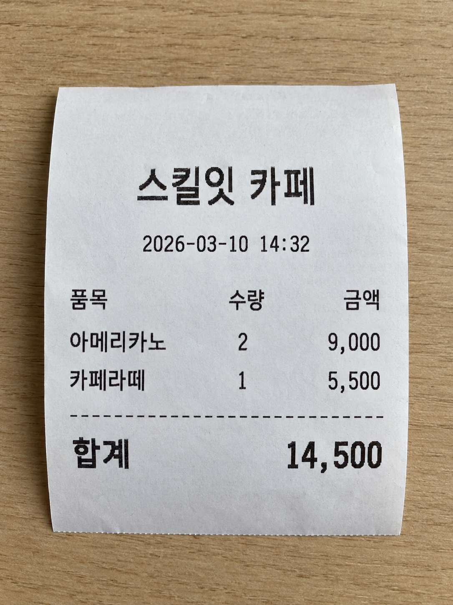

# Lab 15 — Content Understanding 으로 영수증 추출

!!! info "이 실습에서 하는 것"
    영수증 이미지에서 **총 금액 · 날짜 · 상호**를 각각의 **필드 값**으로 뽑습니다.
    글자를 읽는 게 아니라, **쓸 수 있는 데이터**로 만드는 겁니다.

**선행** [Lab 13](lab13-multimodal-image.md) 완료 · **예상 시간** 40분 · **비용** 약 $0.1 미만

---

## 0. OCR 과 무엇이 다른가 (5분)

!!! note "★★ 5강에서 배운 구분이 여기서 실물이 됩니다"
    | | OCR | Content Understanding |
    |---|---|---|
    | 결과 | **글자 뭉치** | **이름 붙은 필드 값** |
    | 예 | `"합계 23,000원 2026-03-10"` | `{"총금액": 23000, "날짜": "2026-03-10"}` |
    | 다음 단계 | 직접 파싱해야 함 | **바로 시스템에 넣을 수 있음** |

    **"필드로 받는다"** 가 나오면 Content Understanding 입니다.
    "글자를 읽는다"면 OCR입니다. 시험에 이 짝으로 나옵니다.

**Lab 13(멀티모달)과도 다릅니다.** 멀티모달 모델도 영수증을 읽고 설명할 수 있지만,
**매번 같은 형식으로 돌려준다는 보장이 없습니다.** CU는 스키마를 미리 정해서 형식을 고정합니다.

---

## 1. 준비 — 될 조건부터 확인 (3분)

!!! warning "이 랩은 앞선 랩들보다 조건이 까다롭습니다"
    아래 네 가지가 모두 맞아야 분석기가 돕니다. **시작 전에 확인하세요.**

    | | 조건 | 확인 방법 | 안 되면 |
    |---|---|---|---|
    | 1 | **Foundry 리소스**가 있어야 함 | Lab 01에서 만든 그것 | Lab 01로 돌아가기 |
    | 2 | **리전**이 Content Understanding 을 지원해야 함 | Studio 설정에서 리소스가 붙는지로 판단 | 강사 화면으로 대체 |
    | 3 | 내 계정에 **`Cognitive Services User`** 역할 | 강사가 미리 부여 | 손 들기 |
    | 4 | 패키지 (코드까지 볼 경우) | 아래 참조 | — |

!!! danger "★ 역할이 왜 따로 필요한가 — 시험에도 이어집니다"
    Lab 02~07 은 **API 키**로 호출했습니다. 키 인증은 역할(RBAC)을 거치지 않습니다.
    그런데 Content Understanding 과 에이전트는 **데이터 평면(data plane)** 작업이라
    **역할이 있어야** 합니다.

    | 역할 | 담당 | 이걸로 되는 것 |
    |---|---|---|
    | `Contributor` | **제어 평면** — 리소스·배포를 만들고 지움 | Lab 01 · 02 |
    | **`Cognitive Services User`** | **데이터 평면** — 추론·추출·에이전트 | **Lab 08 · 09 · 15** |

    `Contributor` 만 있으면 리소스는 만들어지는데 **분석은 거부**됩니다.
    "만들 수는 있는데 쓸 수가 없다"가 이 구분의 증상입니다.

### 패키지 (4절에서 코드를 볼 경우)

```ini title="requirements.txt 에 추가"
azure-ai-contentunderstanding==1.1.0
```

!!! note "오늘 실행하지는 않습니다"
    4절에서 **구조만** 봅니다. 설치는 선택입니다 — 집에서 이어서 해보려면 이 버전으로 맞추세요.

---

## 2. 영수증 이미지 (3분)

아래 영수증을 내려받아 쓰세요. **파일명은 `receipt.png` 그대로** 두시면 됩니다.

<figure markdown>
  { width="300" }
  <figcaption>receipt.png · 1086 × 1448 · 약 2.4MB · AI로 생성한 실습용 예시</figcaption>
</figure>

[↓ receipt.png 내려받기](../assets/receipt-photo.png){ .md-button .md-button--primary download="receipt.png" }

담긴 내용은 이렇습니다. 3절에서 이 값들이 **필드로** 나오는지 확인하게 됩니다.

```text
스킬잇 카페
2026-03-10 14:32
아메리카노  2  9,000
카페라떼    1  5,500
---------------------
합계          14,500
```

!!! tip "실물 영수증으로 해보고 싶다면"
    지갑에 있는 영수증을 써도 됩니다. **구겨지지 않게 펴고, 그림자가 지지 않게 위에서** 찍으세요.
    감열지는 시간이 지나면 흐려져서 **최근 영수증**이 잘 읽힙니다.

---

## 3. 분석기(Analyzer) 만들기 (15분)

여기가 핵심입니다. **무엇을 뽑을지 미리 정의**합니다.

!!! danger "주의 — Foundry 포털에서는 못 만듭니다"
    **사용자 지정 분석기는 Content Understanding Studio 에서만 만들 수 있습니다.**
    Foundry(신규) 포털에도 Content Understanding 플레이그라운드가 있지만,
    거기서는 **미리 만들어진 분석기를 써보는 것만** 되고 사용자 지정 분석기 생성은 지원하지 않습니다.
    Foundry(클래식) 경험은 **2026년 7월 15일 사용 중지**됐습니다.

### 3-1. Studio 접속과 리소스 연결

1. [contentunderstanding.ai.azure.com](https://contentunderstanding.ai.azure.com) 에 접속해 로그인합니다
2. 처음이라면 [설정 페이지](https://contentunderstanding.ai.azure.com/settings) 로 가서 왼쪽 위 **+ Add resource**
3. Lab 01에서 만든 **Foundry 리소스**를 고르고 **Next** → **Save**

!!! tip "체크박스 하나를 꼭 확인하세요"
    **Enable autodeployment for required models if no defaults are available** 가 켜져 있어야 합니다.
    분석기마다 필요한 모델이 다른데, 이걸 켜두면 Studio가 알아서 배포해 줍니다.
    꺼두면 분석할 때 **모델이 없다며 실패**합니다.

### 3-2. 프로젝트 만들기

4. 홈에서 **Create project**
5. 프로젝트 유형은 **Extract content and fields with a custom schema** 를 고릅니다
6. 이름을 적고 **Create**
7. `receipt.png` 를 업로드합니다 → Studio가 파일을 분류하고 **템플릿을 추천**해 줍니다
8. 추천 중 영수증에 맞는 템플릿을 고릅니다

### 3-3. 필드 스키마 정의

템플릿에 딸려온 필드를 확인하고, 필요한 것만 남기거나 직접 추가합니다.

| 필드 이름 | 유형 | 설명 |
|---|---|---|
| `상호` | 문자열 | 가게 이름 |
| `날짜` | 날짜 | 결제 일자 |
| `총금액` | 숫자 | 합계 금액 |

!!! tip "설명을 구체적으로 쓰세요"
    `총금액` 에 "합계, 총액, Total 로 표시된 최종 결제 금액" 처럼 적으면 정확도가 올라갑니다.
    **이게 프롬프트 역할을 합니다.**

9. 다 고쳤으면 **Save**

### 3-4. 테스트

10. **Run analysis** 를 눌러 결과를 봅니다
11. 결과가 **필드별로** 나오는지 확인합니다

```json
{
  "상호":   "스킬잇 카페",
  "날짜":   "2026-03-10",
  "총금액": 14500
}
```

!!! success "이게 핵심입니다"
    OCR이었다면 `"스킬잇 카페 2026-03-10 14:32 아메리카노 2 9,000..."` 한 덩어리였을 겁니다.
    **이름이 붙은 값**으로 나왔다는 게 차이입니다.

### 3-5. 분석기 빌드

결과가 마음에 들면 실제로 쓸 수 있는 분석기로 굽습니다.

12. 페이지 위쪽 **Build analyzer** → 이름을 적고 **Build**
13. 다 되면 **Jump to analyzer list** → 방금 만든 분석기를 선택합니다
14. **키와 엔드포인트가 들어간 코드 샘플**이 보입니다 — 5절에서 볼 구조가 이겁니다

---

## 4. 분석기 두 종류 (5분)

| | 미리 만들어진(prebuilt) 분석기 | 사용자 지정 분석기 |
|---|---|---|
| 준비 | 바로 씀 | **스키마를 직접 정의** ← 방금 한 것 |
| 대상 | 영수증·명함 등 일반 문서 | 우리 회사 양식 |
| 장점 | 빠름 | 원하는 필드만 정확히 |

!!! note "★ 시험 포인트"
    "사내 전용 양식에서 특정 필드를 뽑아야 한다" → **사용자 지정 분석기**
    "일반적인 영수증을 처리한다" → 미리 만들어진 분석기로 충분

---

## 5. 코드에서 부르는 구조 (10분)

!!! warning "오늘은 코드를 실행하지 않습니다"
    시간 때문에 **구조만** 봅니다. 시험이 묻는 것도 "흐름"이지 정확한 메서드명이 아닙니다.

    아래 코드는 **`azure-ai-contentunderstanding==1.1.0` 에서 실제로 돌려 확인한 것**입니다.
    집에서 이어서 해보려면 그대로 쓰시면 됩니다. 다른 버전은 메서드 이름이 다를 수 있습니다.

### endpoint URL은 어디서 복사하나요?

1. [Azure Portal](https://portal.azure.com)에서 **Content Understanding에 연결한 Foundry 리소스**를 엽니다. 프로젝트가 아니라 **부모 리소스**입니다.
2. 왼쪽 메뉴의 **리소스 관리(Resource Management) → 키 및 엔드포인트(Keys and Endpoint)** 를 엽니다.
3. **엔드포인트(Endpoint)** 값을 복사합니다. 아래 주소는 형식 예시이므로 자신의 리소스 값을 그대로 쓰세요.

```text
https://<내-리소스-이름>.services.ai.azure.com/
```

리소스에 따라 `https://<내-리소스-이름>.cognitiveservices.azure.com/` 형태가 표시될 수도 있습니다. 도메인을 임의로 바꾸지 말고 **포털에 표시된 실제 값**을 사용합니다.

!!! warning "주소 세 가지를 구분하세요"
    - `https://contentunderstanding.ai.azure.com/` 는 **Studio 웹사이트 주소**입니다. 코드의 endpoint가 아닙니다.
    - `/api/projects/<프로젝트명>` 이 포함된 **프로젝트 엔드포인트**도 이 클라이언트에 넣지 않습니다.
    - 이 코드에는 **리소스 엔드포인트**를 넣습니다. `/contentunderstanding/...` 나 `?api-version=...` 경로를 직접 덧붙이지 않습니다.

!!! danger "★★ `.env` 의 `PROJECT_ENDPOINT` 를 쓰면 **401** 이 납니다"
    `.env` 에 이미 들어 있는 주소라서 그걸 집기 쉬운데, **그게 함정입니다.**

    ```python
    endpoint = os.getenv("PROJECT_ENDPOINT")   # ❌ Lab 09 에이전트용입니다
    ```

    그러면 이 메시지가 나옵니다.

    ```text
    azure.core.exceptions.ClientAuthenticationError: (None) Unauthorized.
    Access token is missing, invalid, audience is incorrect
    (https://ai.azure.com), or have expired.
    ```

    **"역할이 없다"는 뜻이 아닙니다.** 주소와 토큰의 종류가 어긋난 겁니다.

    | | 원하는 토큰 청중(audience) |
    |---|---|
    | `.../api/projects/<프로젝트>` | `https://ai.azure.com` ← Foundry 프로젝트 |
    | `.../` (리소스) | `https://cognitiveservices.azure.com` ← **CU SDK 가 보내는 것** |

    CU SDK 는 항상 `cognitiveservices` 청중으로 토큰을 받아옵니다. 그래서
    프로젝트 주소에 보내면 거절됩니다. **변수를 따로 만드세요.**

    ```ini title=".env 에 한 줄 추가"
    CU_ENDPOINT=https://<내-리소스-이름>.services.ai.azure.com/
    ```

복사한 주소를 `.env` 의 **`CU_ENDPOINT`** 에 넣고 시작합니다. 기존 `PROJECT_ENDPOINT` 를 고치지 말고 **줄을 새로 추가**하세요 — Lab 09 가 그 값을 씁니다.

```ini title=".env"
CU_ENDPOINT=https://<내-리소스-이름>.services.ai.azure.com/
```

`receipt-analyzer` 도 예시 ID이므로 **3-5 에서 빌드한 분석기 ID와 글자 그대로** 맞춰야 합니다. 이 코드는 **Entra ID 인증**을 쓰므로 키를 붙여 넣는 대신 실행 신원과 필요한 역할을 준비합니다.

[공식 엔드포인트 확인 안내](https://microsoftlearning.github.io/mslearn-ai-information-extraction/Instructions/Exercises/02-content-understanding-api.html#prepare-the-development-environment)

```python title="extract.py"
import os
from dotenv import load_dotenv
from azure.ai.contentunderstanding import ContentUnderstandingClient
from azure.identity import DefaultAzureCredential

load_dotenv()

# 1. 리소스 엔드포인트로 클라이언트 생성 — PROJECT_ENDPOINT 가 아닙니다
client = ContentUnderstandingClient(
    endpoint=os.getenv("CU_ENDPOINT"),
    credential=DefaultAzureCredential())

# 2. 분석 작업 제출 — 로컬 파일은 _binary 쪽
with open("receipt.png", "rb") as f:
    poller = client.begin_analyze_binary(
        analyzer_id="receipt-analyzer",    # 3-5 에서 빌드한 분석기 ID
        binary_input=f.read(),
        content_type="image/png")

# 3. 완료까지 대기 (폴링)
result = poller.result()

# 4. 결과 사용 — 필드가 있으면 필드, 없으면 읽어낸 본문
for c in result.as_dict()["contents"]:
    print(c.get("fields") or c.get("markdown", ""))
```

!!! tip "분석기를 아직 안 만들었어도 — 이건 그냥 돌아갑니다"
    위 코드는 **3-5 에서 `receipt-analyzer` 를 빌드한 뒤**에 돌아갑니다.
    빌드 안 한 상태로 실행하면 `Analyzer not found` 가 납니다.

    **미리 만들어진 분석기**는 아무 준비 없이 바로 됩니다. 집에서 먼저
    연결만 확인하고 싶으면 이걸로 돌려 보세요 — **동작 확인했습니다.**

    ```python title="extract_prebuilt.py"
    import os
    from dotenv import load_dotenv
    from azure.ai.contentunderstanding import ContentUnderstandingClient
    from azure.identity import DefaultAzureCredential

    load_dotenv()

    client = ContentUnderstandingClient(
        os.getenv("CU_ENDPOINT"),          # ★ 리소스 엔드포인트
        DefaultAzureCredential())

    with open("receipt.png", "rb") as f:
        poller = client.begin_analyze_binary(
            analyzer_id="prebuilt-document",   # 사용자 지정 분석기 만들면 그 ID 로
            binary_input=f.read(),
            content_type="image/png")

    result = poller.result()

    for c in result.as_dict()["contents"]:
        print(c.get("markdown", "")[:500])
    ```

    나오는 건 **필드가 아니라 글자 뭉치(markdown)** 입니다. 영수증이 표까지
    포함해 그대로 읽혀 나옵니다. **0절에서 말한 그 차이가 여기서 눈에 보입니다** —
    "읽어내기"까지는 미리 만들어진 분석기로 되고, **"필드로 꺼내기"가 사용자 지정
    분석기가 하는 일**입니다.

    !!! warning "`prebuilt-receipt` 는 피하세요"
        영수증 전용처럼 보이지만 이 리소스에서는 `contents` 가 **빈 배열**로
        오고 경고도 없습니다. 확인된 건 `prebuilt-document` 쪽입니다.

!!! note "입력이 URL이면 메서드가 다릅니다"
    | 입력 | 메서드 |
    |---|---|
    | 로컬 파일 | `begin_analyze_binary(analyzer_id=..., binary_input=...)` |
    | 공개 URL | `begin_analyze(analyzer_id=..., inputs=[AnalysisInput(url=...)])` |

    패키지는 **`azure-ai-contentunderstanding==1.1.0`** 이고,
    호출하려면 리소스에 **`Cognitive Services User`** 역할이 있어야 합니다 (1절 참조).

### ★ `begin_` 과 폴링이 핵심입니다

| 단계 | 의미 |
|---|---|
| `begin_...` | **작업을 제출**만 합니다. 결과가 바로 안 옵니다 |
| `poller.result()` | **끝날 때까지 기다립니다** (SDK가 폴링을 대신해 줍니다) |

!!! note "왜 비동기인가요"
    문서 분석은 시간이 걸립니다. Lab 14의 비디오 생성과 같은 이유입니다.
    **오래 걸리는 작업은 제출 → 폴링** 패턴을 씁니다.

    시험에 "문서 분석 결과를 어떻게 받는가?" → **작업을 제출하고 완료를 기다린다(폴링)** 로 나옵니다.
    REST 는 작업 URL 을 직접 폴링하고, SDK 는 poller 가 대신해 줍니다.

---

## 6. ✅ 체크포인트

!!! success "여기까지 됐으면 통과입니다"
    - [ ] 분석기를 만들고 **필드 3개**를 정의했다
    - [ ] 영수증에서 **필드별 값**이 추출됐다
    - [ ] OCR과 CU의 차이를 한 문장으로 말할 수 있다
    - [ ] `begin_...` → `poller.result()` 구조를 안다

---

## 🔧 안 될 때

??? failure "`Unauthorized ... audience is incorrect (https://ai.azure.com)` 가 납니다"
    **401 입니다. 권한이 아니라 주소 문제입니다.** 5절의 danger 박스를 보세요.

    `endpoint` 에 `/api/projects/...` 가 붙어 있으면 무조건 이 에러가 납니다.
    `.env` 의 `PROJECT_ENDPOINT` 를 그대로 쓰면 그렇게 됩니다.

    ```python
    # ❌
    endpoint = os.getenv("PROJECT_ENDPOINT")
    # ✅
    endpoint = os.getenv("CU_ENDPOINT")   # https://<리소스>.services.ai.azure.com/
    ```

    역할을 의심하기 전에 **주소 끝을 먼저 보세요.** 403 과 401 은 다른 증상입니다.

??? failure "`ModelNotFound` · `Analyzer '...' not found` 가 납니다"
    **분석기를 아직 빌드하지 않은 경우입니다.** 3-5 의 **Build analyzer** 를 눌러야
    `analyzer_id` 로 부를 수 있는 분석기가 생깁니다. Studio 에서 테스트만 돌려본
    상태로는 생기지 않습니다.

    분석기 ID 는 Studio 의 분석기 목록에 적힌 것과 **글자 그대로** 같아야 합니다.

    급하면 미리 만들어진 분석기로 연결만 확인할 수 있습니다.
    **5절의 `extract_prebuilt.py`** 를 그대로 쓰세요 — `analyzer_id` 만
    `prebuilt-document` 로 바꾼 코드입니다.

    단 이건 **필드가 아니라 글자 뭉치**로 나옵니다 — 0절의 그 차이가 눈에 보입니다.

??? failure "에러는 없는데 `contents` 가 빈 배열로 옵니다"
    분석은 접수됐지만 결과가 비었습니다. 3-1 의
    **Enable autodeployment for required models if no defaults are available**
    체크박스를 확인하세요. 분석기가 쓰는 모델이 배포돼 있지 않으면 조용히 비어서 옵니다.

??? failure "분석을 실행하면 권한 오류(403)가 납니다"
    **`Cognitive Services User`** 역할이 없는 경우입니다 (1절 참조).
    `Contributor` 만으로는 안 됩니다. **손을 드세요** — 강사가 역할을 부여합니다.

??? failure "Foundry 포털에서 Content Understanding 메뉴를 못 찾겠습니다"
    **Foundry 포털에서 찾지 마세요.** 사용자 지정 분석기는
    [contentunderstanding.ai.azure.com](https://contentunderstanding.ai.azure.com) 에서 만듭니다 (3절 참조).

    Studio에서 리소스가 붙지 않으면 **리전**이 지원 대상이 아닐 수 있습니다.
    안 되면 손을 드세요 — **강사 화면으로 대체**합니다. 시험 포인트는 전부 전달됩니다.

??? failure "필드 값이 비어 있습니다"
    - 이미지가 흐리거나 글자가 작으면 인식률이 떨어집니다. 더 선명한 걸로 바꿔 보세요
    - 필드 **설명**을 구체적으로 적으세요 — "합계, 총액, Total 로 표시된 금액"
    - 영수증에 그 항목이 실제로 있는지 확인하세요

??? failure "날짜 형식이 이상하게 나옵니다"
    필드 유형을 **날짜**로 지정했는지 확인하세요.
    문자열로 두면 영수증에 적힌 그대로 나옵니다.

??? failure "금액에 쉼표가 들어가 문자열로 나옵니다"
    필드 유형을 **숫자**로 지정하세요.
    그래도 안 되면 설명에 "쉼표 없는 숫자로" 를 추가해 보세요.

---

## 💡 두 강의가 여기서 만납니다

!!! quote ""
    **5강**에서 "필드 매핑 5단계"를 개념으로 배웠고,
    **11강**과 이 실습에서 그걸 실제로 만들었습니다.

    영수증 → 스키마 정의 → 추출 → **시스템에 바로 넣을 수 있는 JSON**.
    이게 "정보 추출" 워크로드의 실체입니다.
